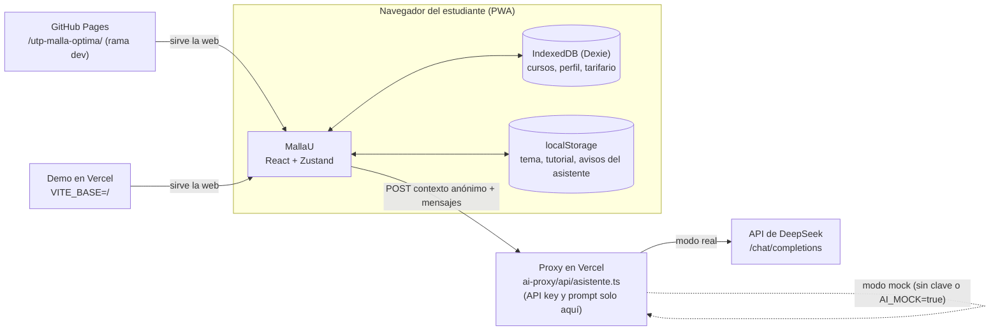

Última actualización: 2026-10-23

# Documentación de MallaU

MallaU es un planificador curricular y presupuestario para estudiantes de pregrado de la UTP (sede Ate).
Funciona en el navegador y guarda los datos en el propio dispositivo. Tiene un asistente académico IA
que, por ahora, responde en modo simulado (mock).

## Índice

| Documento | Para qué sirve |
| --- | --- |
| [estado.md](estado.md) | Foto actual: qué funciona, qué está en mock, tests, ramas, entornos, preguntas abiertas y próximos pasos. **Léelo primero.** |
| [decisiones.md](decisiones.md) | Decisiones de diseño con ID (D-001…), su estado y sus consecuencias. |
| [bitacora.md](bitacora.md) | Registro cronológico del trabajo (del más reciente al más antiguo), con commits y verificación. |
| [fallos.md](fallos.md) | Fallos con ID (F-001…): síntoma, causa raíz, estado, commit y test. |
| [plantillas.md](plantillas.md) | Plantillas para copiar una entrada de bitácora, una decisión o un fallo. |

Otros documentos del repo: [`README.md`](../README.md) (asistente IA y demo en Vercel) y
[`ai-proxy/README.md`](../ai-proxy/README.md) (proxy, variables y paso de mock a real).

## Arquitectura

- Todo lo numérico y lógico (prerrequisitos, costos, carga, what-if, ruta) se calcula en el navegador.
  El asistente solo recibe ese contexto ya calculado y lo explica ([D-001](decisiones.md#d-001)).
- No hay backend propio: el único servidor es la función serverless del proxy ([D-002](decisiones.md#d-002)).
- Los datos del estudiante viven en IndexedDB del dispositivo; al proxy solo va un contexto anónimo
  ([D-006](decisiones.md#d-006)).

## Cómo mantener estos documentos

1. **Antes de trabajar**, lee [estado.md](estado.md) y [decisiones.md](decisiones.md).
2. **Al terminar un cambio**:
   - agrega una entrada arriba en [bitacora.md](bitacora.md) con fecha, rama/PR, commits y cómo se verificó;
   - si cambiaste un criterio, registra una decisión nueva en [decisiones.md](decisiones.md) y marca la
     anterior como *reemplazada* (no la borres);
   - si encontraste o corregiste un fallo, actualiza [fallos.md](fallos.md);
   - actualiza [estado.md](estado.md) (tests, ramas, qué está en mock).
3. Cambia la línea `Última actualización: AAAA-MM-DD` del archivo que edites.
4. **No inventes.** Si algo no se puede confirmar en el código o en git, escríbelo con la marca
   **(por verificar)**. No incluyas claves, tokens, URLs privadas ni datos personales.
5. Usa las plantillas de [plantillas.md](plantillas.md). Los IDs no se reutilizan.
6. El checklist del PR ([`.github/pull_request_template.md`](../.github/pull_request_template.md)) recuerda
   estos pasos.
